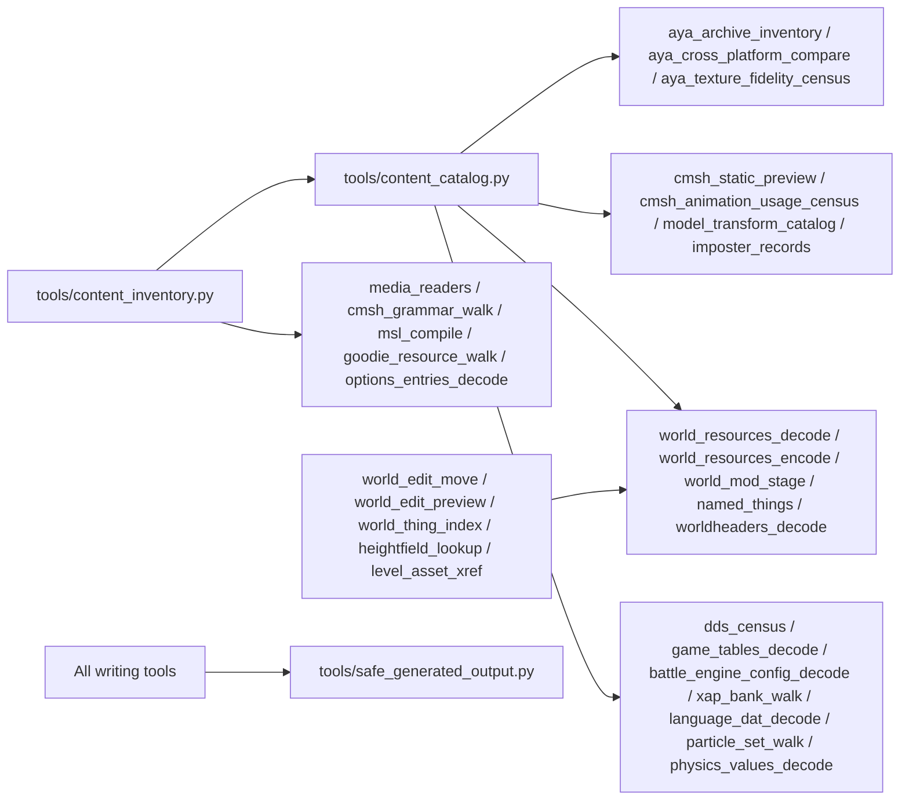

# Repository and Toolkit Map

Status: active source-routing index
Last updated: 2026-11-21 (repurposed into the Onslaught Modding & Content Toolkit; retired Companion GUI, frozen reverse-engineering copy, stale rebuild pointer and obsolete probe tools removed)
Summary: stable ownership, dependency direction, and entry-point routing for the Onslaught Modding & Content Toolkit, with links to the companion repositories in the ecosystem.

This repository (`dlprentice/Onslaught-Career-Editor`, called the Toolkit in its guides) holds the **Onslaught Modding & Content Toolkit**: the JSON Content Catalogue, byte-level Content Inventory, format/modding tools, canonical lore library and cross-project overview. This index answers **where code and responsibility live**. Use [`CURRENT_CAPABILITIES.md`](CURRENT_CAPABILITIES.md) for demonstrated capability, [`GOAL.md`](GOAL.md) for the direction and [`VALIDATION.md`](VALIDATION.md) for gate selection.

Where the other parts of the ecosystem live:

- Native game port (and player Career/Backups/Mods/Editor UI): [Onslaught CE](https://github.com/dlprentice/onslaught-ce)
- Byte-matching decompilation: [onslaught-decomp](https://github.com/dlprentice/onslaught-decomp)
- Maintained game documentation (formats, saves, mechanics, levels, engine): [onslaught-preservation](https://github.com/dlprentice/onslaught-preservation)
- Proof-of-concept Godot 4 C# rebuild: [onslaught-godot](https://github.com/dlprentice/onslaught-godot)

## Dependency direction



## Content catalogue & inventory

- [`tools/content_catalog.py`](tools/content_catalog.py) owns local retail-content surveying, record emission and loader-rule relationship joins; [`tools/content_catalog.schema.json`](tools/content_catalog.schema.json) owns its record schema; [`tools/content_catalog_tests.py`](tools/content_catalog_tests.py) runs authored tests; [`tools/content_catalog_gate.py`](tools/content_catalog_gate.py) validates a selected retail installation.
- [`tools/imposter_records.py`](tools/imposter_records.py) owns `IMPT` / `CIMP` / `IMPS` / `VIEW` imposter record parsing and validation, tested by [`tools/imposter_records_tests.py`](tools/imposter_records_tests.py).
- [`tools/content_inventory.py`](tools/content_inventory.py) owns the byte-level account and `asset-metadata.jsonl` emission, backed by [`tools/media_readers.py`](tools/media_readers.py), [`tools/particle_set_walk.py`](tools/particle_set_walk.py) and [`tools/physics_values_decode.py`](tools/physics_values_decode.py); [`tools/content_inventory.schema.json`](tools/content_inventory.schema.json) owns its row schemas; [`tools/content_inventory_tests.py`](tools/content_inventory_tests.py) tests authored installs; [`tools/content_inventory_gate.py`](tools/content_inventory_gate.py) validates a run against a selected retail install.

## World, MSL & modding tools

- World codec & CE mod staging: [`tools/world_resources_decode.py`](tools/world_resources_decode.py), [`tools/world_resources_encode.py`](tools/world_resources_encode.py), [`tools/world_mod_stage.py`](tools/world_mod_stage.py), [`tools/world_thing_index.py`](tools/world_thing_index.py), [`tools/world_edit_preview.py`](tools/world_edit_preview.py), [`tools/world_edit_move.py`](tools/world_edit_move.py), [`tools/named_things.py`](tools/named_things.py), [`tools/heightfield_lookup.py`](tools/heightfield_lookup.py), [`tools/worldheaders_decode.py`](tools/worldheaders_decode.py).
- Mission scripting (`.msl`): [`tools/msl_compile.py`](tools/msl_compile.py), [`tools/msl_gate.py`](tools/msl_gate.py), [`tools/mission_script_inspect.py`](tools/mission_script_inspect.py).
- Asset & archive inspection: [`tools/aya_archive_inventory.py`](tools/aya_archive_inventory.py), [`tools/aya_corpus_chunk_inventory.py`](tools/aya_corpus_chunk_inventory.py), [`tools/aya_cross_platform_compare.py`](tools/aya_cross_platform_compare.py), [`tools/aya_texture_fidelity_census.py`](tools/aya_texture_fidelity_census.py), [`tools/cmsh_static_preview.py`](tools/cmsh_static_preview.py), [`tools/cmsh_grammar_walk.py`](tools/cmsh_grammar_walk.py), [`tools/cmsh_animation_usage_census.py`](tools/cmsh_animation_usage_census.py), [`tools/model_transform_catalog.py`](tools/model_transform_catalog.py), [`tools/level_asset_xref.py`](tools/level_asset_xref.py), [`tools/dds_census.py`](tools/dds_census.py), [`tools/export_asset_catalog.py`](tools/export_asset_catalog.py), [`tools/export_language_corpus.py`](tools/export_language_corpus.py), [`tools/export_video_manifest.py`](tools/export_video_manifest.py).
- Game tables, media & audio: [`tools/battle_engine_config_decode.py`](tools/battle_engine_config_decode.py), [`tools/game_tables_decode.py`](tools/game_tables_decode.py), [`tools/goodie_resource_walk.py`](tools/goodie_resource_walk.py), [`tools/xap_bank_walk.py`](tools/xap_bank_walk.py), [`tools/language_dat_decode.py`](tools/language_dat_decode.py), [`tools/options_entries_decode.py`](tools/options_entries_decode.py).

## Repository owners

| Path | Authority |
| --- | --- |
| [`tools/`](tools/README.md) | JSON Content Catalogue, Content Inventory, format decoders/encoders, mod-staging tools, safety/doc checks and test runner (`run_tool_tests.py`). Root [`package.json`](package.json) owns npm shortcuts. |
| [`tools/godot_reader_fixtures/`](tools/godot_reader_fixtures/README.md) | Five C# reader source files mirrored from `onslaught-godot` and read as plain text by `particle_set_walk_tests.py` and `physics_values_decode_tests.py` to prevent table drift. |
| [`tools/format_contracts/`](tools/format_contracts/README.md) | Pinned format layout table (`battle-engine-config-layout.tsv`) mirrored from `onslaught-preservation` for `battle_engine_config_decode_tests.py`. |
| [`tests_shared/`](tests_shared/fixtures/README.md) | Narrow reviewed save baseline (`gold_career_save.bin`) used by inventory tests; never a dumping ground for retail assets. |
| [`lore/`](lore/_index.md) and [`lore-book/`](lore-book/BOOK.md) | Canonical public lore and development history library and its reading guide. |
| [`references/`](references/) | Pinned public source-reference submodules (`Onslaught` and `AYAResourceExtractor`). Source references only, not proof of retail behavior. |
| `local-data/` | Ignored checkout-local directory for generated catalogues, inventories, Python venvs and private local outputs. |
| `local-lab/` | Ignored maintainer-local evidence directory (absent in public clones); see [`LOCAL_LAB_OVERLAY.md`](LOCAL_LAB_OVERLAY.md). |

## Documentation truth owners

| Question | Owner |
| --- | --- |
| What is the contributor contract? | [`CONTRIBUTING.md`](CONTRIBUTING.md) for contributors; [`AGENTS.md`](AGENTS.md) for automated-agent rules |
| What do we want across the ecosystem? | [`GOAL.md`](GOAL.md) |
| What is the cross-project work queue? | [`PROGRAM.md`](PROGRAM.md) |
| What does the Toolkit currently demonstrate? | [`CURRENT_CAPABILITIES.md`](CURRENT_CAPABILITIES.md) |
| What do CE and the Godot rebuild demonstrate? | [CE releases](https://github.com/dlprentice/onslaught-ce/releases) and [onslaught-godot parity](https://github.com/dlprentice/onslaught-godot/blob/main/rebuild/PARITY.md) |
| Where does Toolkit code live? | This index and [`tools/README.md`](tools/README.md) |
| What is known about the retail game's formats, saves and mechanics? | [onslaught-preservation](https://github.com/dlprentice/onslaught-preservation) |
| What is the reverse-engineering/naming authority? | [onslaught-decomp](https://github.com/dlprentice/onslaught-decomp) |
| Where do ignored local outputs and evidence live? | [`LOCAL_LAB_OVERLAY.md`](LOCAL_LAB_OVERLAY.md) |
| Which validation command applies? | [`VALIDATION.md`](VALIDATION.md) and [`package.json`](package.json) |
| What are the documentation header rules? | [`DOCUMENTATION.md`](DOCUMENTATION.md) |
| What shipped in the retired WinUI app? | [`CHANGELOG.md`](CHANGELOG.md) |

## Keeping this map current

Update this index when a root document owner, tool family or fixture boundary changes. Do not add volatile file counts or coverage percentages here. After edits, verify with:

```bash
git diff --check
npm run test:docs
python3 -B tools/md_reachability_check.py
```
