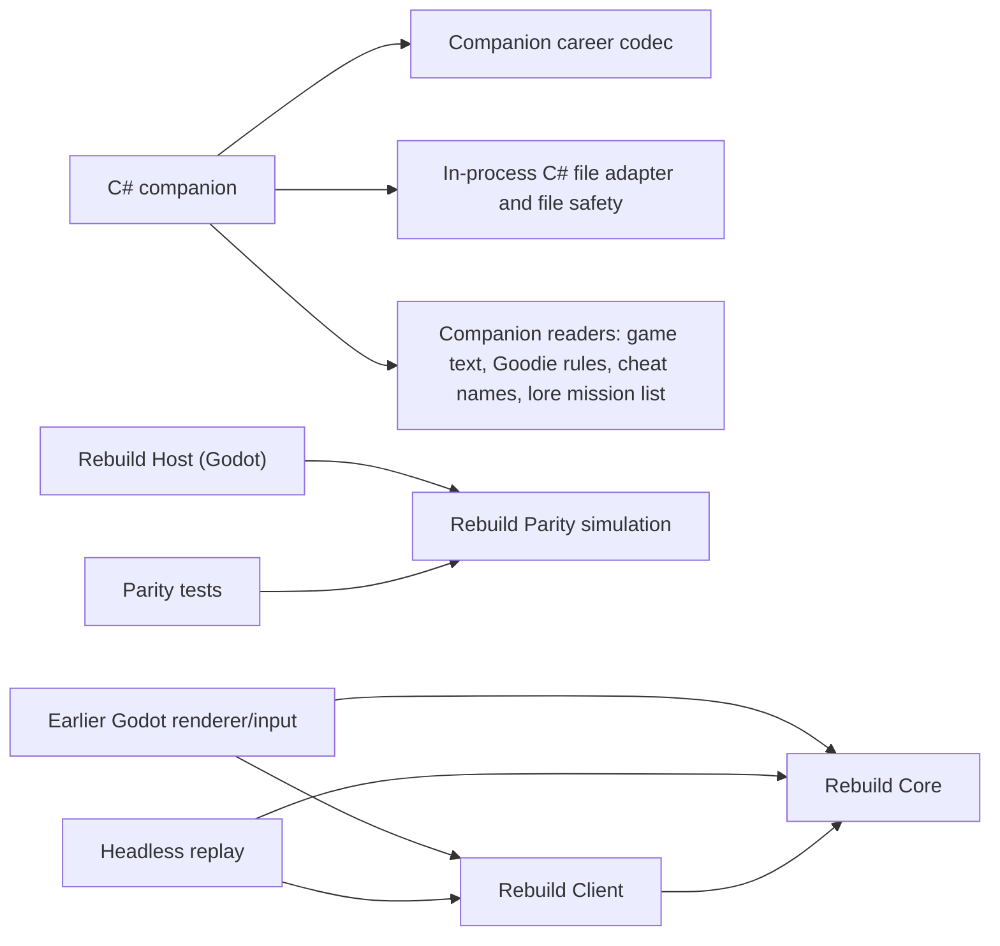

# Repository and Application Map

Status: active source-routing index
Last updated: 2026-10-23 (the companion owns original-game and CE support; the related repositories and frozen rebuild are linked)
Summary: stable ownership, dependency direction, and code-entry routing for the
Onslaught Toolkit repository: the companion, the game documentation, tools and the
Godot rebuild.

This index answers **where code and responsibility live**. It does not restate
what is currently proved or working. Use [`CURRENT_CAPABILITIES.md`](CURRENT_CAPABILITIES.md)
for demonstrated capability, [`GOAL.md`](GOAL.md) for the direction,
[`reverse-engineering/RE-INDEX.md`](reverse-engineering/RE-INDEX.md) for the game documentation, and
[`rebuild/PROVENANCE.md`](rebuild/PROVENANCE.md) for the rebuild's evidence and licence boundary. The
decompilation's public export is [onslaught-decomp](https://github.com/dlprentice/onslaught-decomp); the native port's source and downloads are
published separately as [Onslaught CE](https://github.com/dlprentice/onslaught-ce), never from this repository. The Ghidra checkpoint and campaign machinery are in
the private `onslaught-re-archive`. Do not embed volatile counts here.

## Dependency direction



The arrows are source dependencies, not priority. `rebuild/` is a frozen copy; the rebuild is developed in
[onslaught-godot](https://github.com/dlprentice/onslaught-godot). In it, `OnslaughtRebuild.Parity` owns the simulation and `OnslaughtRebuild.Host` the presentation; the earlier Core, Client, Headless and Godot projects are
reference material. The companion is the public player product for the original game and Onslaught CE. It is a C#
application built in code and owns its file-safety source.
The companion (GPL-3.0-only) has no dependency on the rebuild or private retail assets.

| Project | Declared role and dependencies |
| --- | --- |
| [`OnslaughtToolkit.Godot`](companion/OnslaughtToolkit.Godot/README.md) | Godot .NET C# application built in code: interface, theme, career codec, the game's music and voices, model and texture readers with glTF and PNG export, file safety and its in-process adapter, the level data layer (world bodies and level archives, checked against the Toolkit's reference), with its contract tests. No GDScript or editor-authored scene. |
| [`OnslaughtRebuild.Parity`](rebuild/OnslaughtRebuild.Parity/OnslaughtRebuild.Parity.csproj) | The rebuild's simulation owner: a float-exact C# port of the decompilation's simulation, deterministic, with no presentation, filesystem, clock, process, network, or GPU dependency. No project references. |
| [`OnslaughtRebuild.Parity.Tests`](rebuild/OnslaughtRebuild.Parity.Tests/OnslaughtRebuild.Parity.Tests.csproj) | Parity tests against recorded retail and native-port references ([rebuild/README.md](rebuild/README.md#working-lane)); references Parity. |
| [`OnslaughtRebuild.Host`](rebuild/OnslaughtRebuild.Host/OnslaughtRebuild.Host.csproj) | The rebuild's presentation owner: a Godot .NET project built in code that draws the parity core and supplies input; references Parity. |
| [`OnslaughtRebuild.Core`](rebuild/OnslaughtRebuild.Core/OnslaughtRebuild.Core.csproj) | Earlier fixed-point rebuild, kept as reference. Deterministic simulation truth; no presentation, filesystem, clock, process, network, or GPU dependency. |
| [`OnslaughtRebuild.Client`](rebuild/OnslaughtRebuild.Client/OnslaughtRebuild.Client.csproj) | Input-to-fixed-step and presentation-lifecycle adapter; references Core. |
| [`OnslaughtRebuild.Godot`](rebuild/OnslaughtRebuild.Godot/OnslaughtRebuild.Godot.csproj) | Rendering, audio, native integration, and player input; references Client and Core. |

Host boundary: Linux owns native Godot and Core/Client/headless execution. The WinUI shell, its UI tests and the CLI
were removed on 2026-10-15, and the patching core it left behind (AppCore, with its tests and the `patches/` catalog)
on 2026-10-22; Git keeps them. The never-built Windows VM was retired;
no Windows validation host is currently provisioned here.
[`VALIDATION.md`](VALIDATION.md) distinguishes focused service tests, native
runtime checks and unfinished acceptance.

[`rebuild/OnslaughtRebuild.slnx`](rebuild/OnslaughtRebuild.slnx) is the rebuild's
machine-readable project list. [`rebuild/README.md`](rebuild/README.md) owns
the rebuild assembly contract in detail.

## Companion route

[`Main.tscn`](companion/OnslaughtToolkit.Godot/Main.tscn) only attaches
[`CompanionApp`](companion/OnslaughtToolkit.Godot/Ui/CompanionApp.cs), which builds the
whole interface and theme in code. [`CareerSave`](companion/OnslaughtToolkit.Godot/Careers/CareerSave.cs)
owns format interpretation, selected-byte previews and comparison;
[`CampaignGraph`](companion/OnslaughtToolkit.Godot/Careers/CampaignGraph.cs) turns the stored
nodes and links into the campaign map;
[`SaveSession`](companion/OnslaughtToolkit.Godot/Careers/SaveSession.cs) owns the opened
snapshot and [`CareerWorkspace`](companion/OnslaughtToolkit.Godot/Careers/CareerWorkspace.cs)
the open, publish, compare, backup and install workflows. The in-process
[adapter](companion/OnslaughtToolkit.Godot/Files/ProtectedSaveFiles.cs) uses
`SaveLabFileTransaction` and `FileMutationSafety` in `Files/`;
[`GameWrites`](companion/OnslaughtToolkit.Godot/Files/GameWrites.cs) owns backup sets, the
running-game check and verified writes into the game folder (Linux exchange and the portable
path). [`GameLibrary`](companion/OnslaughtToolkit.Godot/Game/GameLibrary.cs) finds the game
through Steam, notices when its careers change and reads its text through
`GameTextCatalog`; [`GameFolder`](companion/OnslaughtToolkit.Godot/Game/GameFolder.cs) owns
the folder's files, the remembered choices and the backup folder;
[`OptionsFile`](companion/OnslaughtToolkit.Godot/Options/OptionsFile.cs) owns the options block;
[`GameAudio`](companion/OnslaughtToolkit.Godot/Media/GameAudio.cs) lists the game's music and
voice lines, and the [art and sound](companion/OnslaughtToolkit.Godot/Assets/AssetLibrary.cs) browser
reads the game's models, textures and sound effects and saves glTF, PNG and WAV copies; [`LoreLibrary`](companion/OnslaughtToolkit.Godot/Lore/LoreLibrary.cs)
embeds `lore/` and `lore-book/BOOK.md`. In the interface,
[`AppServices`](companion/OnslaughtToolkit.Godot/Ui/AppServices.cs) is what every page may use
(including career naming), [`SaveChoice`](companion/OnslaughtToolkit.Godot/Ui/SaveChoice.cs)
asks where a change is saved, [`CareerCards`](companion/OnslaughtToolkit.Godot/Ui/CareerCards.cs)
lists the game's careers and [`GameArt`](companion/OnslaughtToolkit.Godot/Ui/GameArt.cs) reads
the manual's images from the install. Pages live in
[`Ui/Pages/`](companion/OnslaughtToolkit.Godot/Ui/Pages/). Contract tests live in
[`Tests/`](companion/OnslaughtToolkit.Godot/Tests/) and never enter a release export.

## Repository owners

| Path | Authority |
| --- | --- |
| [`companion/`](companion/OnslaughtToolkit.Godot/README.md) | GPL-3.0-only Godot .NET toolkit, a C# application built in code with its in-process file adapter. `tools/companion_godot.py` owns pinned .NET-engine routes (build, test, capture, run, export); `tools/godot_host.py` supplies shared engine discovery and process support. |
| [`reverse-engineering/`](reverse-engineering/RE-INDEX.md) | Documentation of the game as prose and specs: formats, mechanics, saves, assets, source notes, function notes and contracts, each bound to its specimen or source. No Ghidra database or decompiler output. |
| `local-lab/` | Ignored machine-local evidence: retail safe copies, historical campaign generations, captures, reviewer reports, frozen proof graphs, the retired working Ghidra project and `rebuild-godot/` staging. It is a real directory inside the Archive B checkout; fresh clones and child worktrees lack it. [`LOCAL_LAB_OVERLAY.md`](LOCAL_LAB_OVERLAY.md) owns canonical absolute-path / `BEA_LOCAL_LAB` routing; consult relevant `local-lab/INDEX.md` sections for the retained corpus. |
| `local-data/` | The real ignored repository child for `host-attestations/`, current retail/media inputs, operational outputs and grouped `recovered/` packages; its `AGENTS.md` owns the internal map. Unused `windows-vm/` and `vm-media/` staging was retired. `_recovered-worktrees/` and `windows-profile-2026-08-28/` retain protected historical Ghidra material in place. `local-proofs/` remains a reserved ignored/publication-denied name, not a current data owner. |
| `.artifacts/` | Ignored legacy validation, screenshot and publish output. It may contain unique evidence; preserve coupled tool paths, put new general-purpose output in `local-data/`, and use the migration deletion queue for authorized retirement. |
| [`rebuild/`](rebuild/README.md) | The GPL-licensed Godot rebuild (Parity simulation, Host presentation) and the earlier fixed-point projects kept as reference; provenance, determinism, and parity contracts are subtree-owned. |
| [`tools/`](tools/README.md) | Format decoders, asset export, capture analysis, the companion and Godot launchers, and the documentation and safety gates. Root [`package.json`](package.json) owns commands. |
| [`tests_shared/`](tests_shared/fixtures/README.md) | Narrow reviewed cross-project fixtures; never a dumping ground for retail saves or assets. |
| [`lore/`](lore/) and `lore-book/` | Canonical public lore/history library and its entry guide. |
| [`references/`](references/) | David's forks of Stuart Gillam's GPL `Onslaught` source and `AYAResourceExtractor`, pinned at `c3d8ac4` and `53b10b0` by `ONSLAUGHT_PIN` and `EXTRACTOR_PIN` in [`aya_extractor_source_audit.py`](tools/aya_extractor_source_audit.py). Preserve pins, licences and provenance. These are source references, not proof of retail behavior. |
| [`roadmap/`](roadmap/original-binary-online-multiplayer-feasibility.md) | Bounded original-binary multiplayer feasibility, and the [Companion level editor plan](roadmap/companion-level-editor.md). [GOAL.md](GOAL.md) owns the outcomes and [PROGRAM.md](PROGRAM.md) owns remaining work. |

## Documentation truth owners

One owner per row. If a document belongs in two rows, the routing layer is
wrong — fix the rows, not the document.

| Question | Owner |
| --- | --- |
| What is the contributor contract? | [`AGENTS.md`](AGENTS.md) — restated nowhere |
| What do we want? | [`GOAL.md`](GOAL.md) |
| What is the execution work-queue state (done/next/queued, with receipts)? | [`PROGRAM.md`](PROGRAM.md) |
| What does the product/rebuild currently demonstrate? | [`CURRENT_CAPABILITIES.md`](CURRENT_CAPABILITIES.md) |
| Where does our code and responsibility live? | This index |
| What is known about the retail game? | [`reverse-engineering/RE-INDEX.md`](reverse-engineering/RE-INDEX.md) and its routed documents; the private decompilation is the authority behind them |
| How are retail function/behavior contracts graded and located? | [`CONTRACTS.md`](CONTRACTS.md) |
| What evidence may enter the rebuild? | [`rebuild/PROVENANCE.md`](rebuild/PROVENANCE.md) |
| What makes the rebuild deterministic, and what is its measured parity? | [the parity core's contract](rebuild/DETERMINISM.md#the-parity-core-onslaughtrebuildparity) (the rest of that page is the earlier Core's), [`rebuild/PARITY.md`](rebuild/PARITY.md) |
| Where does ignored machine-local evidence live? | [`LOCAL_LAB_OVERLAY.md`](LOCAL_LAB_OVERLAY.md); on this host the canonical checkout's real `local-lab/` directory |
| Which validation command applies? | [`VALIDATION.md`](VALIDATION.md) and [`package.json`](package.json) |
| What shipped, per release? | [`CHANGELOG.md`](CHANGELOG.md) (the retired WinUI app's releases) |

### Lane front doors

- **Game documentation:** [`reverse-engineering/RE-INDEX.md`](reverse-engineering/RE-INDEX.md)
- **Rebuild:** [`rebuild/README.md`](rebuild/README.md) +
  [`rebuild/PROVENANCE.md`](rebuild/PROVENANCE.md)
- **Machine-local evidence lane:** [`LOCAL_LAB_OVERLAY.md`](LOCAL_LAB_OVERLAY.md)
  + canonical-checkout `local-lab/INDEX.md`
- **Companion:** [`Godot companion`](companion/OnslaughtToolkit.Godot/README.md) /
  [`CURRENT_CAPABILITIES.md`](CURRENT_CAPABILITIES.md) /
  [`CHANGELOG.md`](CHANGELOG.md)

## Keeping this map current

Update this index when one of these stable source contracts changes:

- a companion sidebar page is added, removed, or remapped;
- a project reference or assembly responsibility changes;
- reusable behavior moves between the companion and a rebuild assembly;
- a root source/evidence owner is added, removed, or superseded.

Do not add volatile file counts, campaign counts, coverage percentages, current
task status, or capability claims here. Those values belong to measured owners.
For a map-only change, compare the affected row with its named source owner, then use the docs gate.
Navigation/project-reference searches below apply when those relationships change; reachability checks
apply when adding/removing document routes, not every wording edit:

```bash
# Navigation or assembly-dependency changes:
rg -n 'class \w+Page\b' companion/OnslaughtToolkit.Godot/Ui/Pages
rg -n '<ProjectReference' -g '*.csproj' -g '!references/**'
# Documentation changes:
git diff --check
npm run test:docs
# Added/removed documentation routes:
python tools/md_reachability_check.py
```
